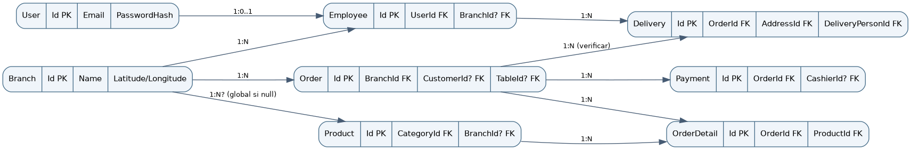

# Diccionario de datos y modelo relacional

**Proyecto:** SaborExpress | **Autor / integrante:** Yerson Stiven Cuellar Rubiano | **Ficha:** 3145555 | **Fecha:** 14 de octubre de 2026 | **Versión documental:** 4.0

**Estado de la evidencia:** inspección documental y estática del código. Las pruebas de ejecución y los datos institucionales no aportados no se presumen realizados.

## 1. Procedencia y limitación

Los campos listados a continuación se transcriben de modelos C# inspeccionados en `Modules/<Dominio>/Models` y del `AppDbContext`. **Son propiedades de entidades**, no una exportación certificada del DDL físico (nombres de columnas, índices, nulabilidad y reglas SQL deben validarse en migraciones y motor objetivo). PK/FK se infiere de los nombres y navegaciones y corresponde a relaciones programadas que necesitan comprobarse físicamente.

## 2. Modelos de datos inspeccionados

### Entidad User

| Propiedad/Tipo visible | Interpretación de dominio |
| --- | --- |
| Id:int PK | Id — propiedad del modelo C# |
| Email:string? | Email — propiedad del modelo C# |
| PasswordHash:string | PasswordHash — propiedad del modelo C# |
| Status:bool | Status — propiedad del modelo C# |
| MustChangePassword:bool | MustChangePassword — propiedad del modelo C# |
| LastLogin:DateTime? | LastLogin — propiedad del modelo C# |
| CreatedAt:DateTime | CreatedAt — propiedad del modelo C# |
| FailedLoginAttempts:int | FailedLoginAttempts — propiedad del modelo C# |
| LockoutEnd:DateTime? | LockoutEnd — propiedad del modelo C# |
| EmailConfirmed:bool | EmailConfirmed — propiedad del modelo C# |

### Entidad Employee

| Propiedad/Tipo visible | Interpretación de dominio |
| --- | --- |
| Id:int PK | Id — propiedad del modelo C# |
| UserId:int FK | UserId — propiedad del modelo C# |
| Name:string | Name — propiedad del modelo C# |
| LastName:string? | LastName — propiedad del modelo C# |
| Document:string | Document — propiedad del modelo C# |
| Phone:string? | Phone — propiedad del modelo C# |
| BranchId:int? FK | BranchId — propiedad del modelo C# |
| Status:string | Status — propiedad del modelo C# |
| Vehicle:string? | Vehicle — propiedad del modelo C# |
| Plate:string? | Plate — propiedad del modelo C# |
| IsAvailable:bool | IsAvailable — propiedad del modelo C# |
| BasePay:decimal | BasePay — propiedad del modelo C# |

### Entidad Branch

| Propiedad/Tipo visible | Interpretación de dominio |
| --- | --- |
| Id:int PK | Id — propiedad del modelo C# |
| Name:string | Name — propiedad del modelo C# |
| Address:string? | Address — propiedad del modelo C# |
| Phone:string? | Phone — propiedad del modelo C# |
| Status:bool | Status — propiedad del modelo C# |
| Latitude:decimal | Latitude — propiedad del modelo C# |
| Longitude:decimal | Longitude — propiedad del modelo C# |
| PublicKitchenCode:string? | PublicKitchenCode — propiedad del modelo C# |
| CreatedAt:DateTime | CreatedAt — propiedad del modelo C# |

### Entidad Product

| Propiedad/Tipo visible | Interpretación de dominio |
| --- | --- |
| Id:int PK | Id — propiedad del modelo C# |
| CategoryId:int FK | CategoryId — propiedad del modelo C# |
| BranchId:int? FK | BranchId — propiedad del modelo C# |
| Name:string | Name — propiedad del modelo C# |
| Description:string | Description — propiedad del modelo C# |
| Price:decimal | Price — propiedad del modelo C# |
| Photo:string? | Photo — propiedad del modelo C# |
| PreparationTimeInMinutes:int | PreparationTimeInMinutes — propiedad del modelo C# |
| Status:bool | Status — propiedad del modelo C# |
| CreatedAt:DateTime | CreatedAt — propiedad del modelo C# |

### Entidad Order

| Propiedad/Tipo visible | Interpretación de dominio |
| --- | --- |
| Id:int PK | Id — propiedad del modelo C# |
| CustomerId:int? FK | CustomerId — propiedad del modelo C# |
| EmployeeId:int? FK | EmployeeId — propiedad del modelo C# |
| TableId:int? FK | TableId — propiedad del modelo C# |
| BranchId:int FK | BranchId — propiedad del modelo C# |
| AddressId:int? FK | AddressId — propiedad del modelo C# |
| OrderType:enum | OrderType — propiedad del modelo C# |
| Channel:enum | Channel — propiedad del modelo C# |
| Status:enum | Status — propiedad del modelo C# |
| SubTotal:decimal | SubTotal — propiedad del modelo C# |
| Tax:decimal | Tax — propiedad del modelo C# |
| Total:decimal | Total — propiedad del modelo C# |
| Notes:string? | Notes — propiedad del modelo C# |
| GuestName:string? | GuestName — propiedad del modelo C# |
| CreatedAt:DateTime | CreatedAt — propiedad del modelo C# |
| UpdatedAt:DateTime? | UpdatedAt — propiedad del modelo C# |

### Entidad OrderDetail

| Propiedad/Tipo visible | Interpretación de dominio |
| --- | --- |
| Id:int PK | Id — propiedad del modelo C# |
| OrderId:int FK | OrderId — propiedad del modelo C# |
| ProductId:int FK | ProductId — propiedad del modelo C# |
| LastModifiedByEmployeeId:int? FK | LastModifiedByEmployeeId — propiedad del modelo C# |
| Quantity:int | Quantity — propiedad del modelo C# |
| UnitPrice:decimal | UnitPrice — propiedad del modelo C# |
| SubTotal:decimal | SubTotal — propiedad del modelo C# |
| Notes:string? | Notes — propiedad del modelo C# |
| IsToGo:bool | IsToGo — propiedad del modelo C# |
| BatchNumber:int | BatchNumber — propiedad del modelo C# |
| Status:enum | Status — propiedad del modelo C# |

### Entidad Payment

| Propiedad/Tipo visible | Interpretación de dominio |
| --- | --- |
| Id:int PK | Id — propiedad del modelo C# |
| OrderId:int FK | OrderId — propiedad del modelo C# |
| CashierId:int? FK | CashierId — propiedad del modelo C# |
| Method:enum | Method — propiedad del modelo C# |
| Amount:decimal | Amount — propiedad del modelo C# |
| Status:enum | Status — propiedad del modelo C# |
| PaidAt:DateTime | PaidAt — propiedad del modelo C# |
| WompiReference:string? | WompiReference — propiedad del modelo C# |
| WompiTransactionId:string? | WompiTransactionId — propiedad del modelo C# |

### Entidad Delivery

| Propiedad/Tipo visible | Interpretación de dominio |
| --- | --- |
| Id:int PK | Id — propiedad del modelo C# |
| OrderId:int FK | OrderId — propiedad del modelo C# |
| AddressId:int FK | AddressId — propiedad del modelo C# |
| DeliveryPersonId:int FK | DeliveryPersonId — propiedad del modelo C# |
| Status:enum | Status — propiedad del modelo C# |
| AssignedAt:DateTime | AssignedAt — propiedad del modelo C# |
| DeliveredAt:DateTime? | DeliveredAt — propiedad del modelo C# |
| CustomerRating:int? | CustomerRating — propiedad del modelo C# |
| CustomerRatingComment:string? | CustomerRatingComment — propiedad del modelo C# |
| RatedAt:DateTime? | RatedAt — propiedad del modelo C# |


## 3. Entidades adicionales registradas en DbContext

PasswordResetCodes, Roles, Permissions, RolePermissions, UserRoles, Customers, Categories, OrderStatusHistories, OrderDetailHistories, Tables, Reviews, Addresses, UserPreferences, BranchSetting, BranchOperationalSettings, UserSettings, EmailConfirmationCodes, RefreshTokens, EmployeeSchedules, DailyMenuItems, Invoices, EmployeeActivationCodes y Notifications. Sus tablas y columnas deben cotejarse con modelos y configuraciones respectivas; no se inventan columnas.

## 4. Relaciones de negocio



1. `User 1—0..1 Employee`; `Employee` referencia `UserId`. 2. `Branch 1—N Order`, `Branch 1—N Employee` (opcional para employee) y `Branch 1—N Product` (opcional para producto global). 3. `Order 1—N OrderDetail` y `Order 1—N Payment`. 4. `OrderDetail N—1 Product`. 5. `Delivery N—1 Order`, `Address` y `Employee` como repartidor. 6. `Product N—1 Category`.

## 5. Reglas de integridad que se deben comprobar

Montos DECIMAL adecuados para moneda; no aceptar negativos; `CustomerRating` en 1..5; `Quantity` mayor que cero; `Total` consistente con subtotales/impuestos; unicidad de referencia Wompi; índice sobre pedido y estados cuando aplique; privacidad de contraseñas/token; políticas de borrado y registros históricos. El modelo C# por sí mismo no demuestra todos estos CHECK/UNIQUE/INDEX físicos.

## 6. Obtención correcta del esquema SQL

Seleccionar el proveedor real en ambiente aislado. Desde la carpeta backend, con `dotnet-ef` compatible y herramientas restauradas, usar `dotnet ef migrations script --idempotent --output esquema-generado.sql` o extraer el DDL del motor. Verificar que migraciones sean apropiadas para ese proveedor. El archivo `5-database/database-schema.sql` contiene instrucciones de catálogo y NO es un DDL de producción inventado.

## 7. Protección de información

No subir respaldos reales, contraseñas, claves API, tokens, números de documentos ni datos de clientes al repositorio de documentación. Toda captura de base de datos debe ser sintética o anonimizada y autorizada.


## 7. Modelado de integridad de datos

Los campos enumerados provienen de clases C# examinadas. **No son la DDL física validada.** EF Core permite configuraciones de nombres de tablas, índices, tipos, longitud y nulabilidad que solo se confirman consultando `Data/Configurations`, migraciones y esquema de motor en ejecución.


### User. User

**Propiedades observadas (C#):** `Id`, `Email`, `PasswordHash`, `Token`, `Status`, `MustChangePassword`, `LastLogin`, `CreatedAt`, `FailedLoginAttempts`, `LockoutEnd`, `EmailConfirmed`.

**Integridad y dominio:** Id clave primaria; Email opcional en modelo; PasswordHash sensible; múltiples roles por UserRole; bloqueo temporal requiere lógica de autenticación.

**Controles propuestos:** definir longitudes explícitas, restricciones de unicidad donde el negocio lo demande, control de concurrencia, reglas de borrado y auditoría. Extraer índices del esquema real; no usar este inventario como SQL aplicable directamente.

**Verificación:** generar migración en base efímera, inspeccionar los constraints EF, comparar con SQL real y documentar divergencias por motor.


### Employee. Employee

**Propiedades observadas (C#):** `Id`, `UserId`, `Name`, `LastName`, `Document`, `Phone`, `Address`, `Vehicle`, `Plate`, `BranchId`, `Status`, `IsAvailable`, `BasePay`, `CvFile`, `CvFilename`, `CvContentType`, `CreatedAt`.

**Integridad y dominio:** UserId obligatorio, BranchId opcional; CV en byte[] requiere política de tamaño, cifrado y retención; disponibilidad relevante para reparto.

**Controles propuestos:** definir longitudes explícitas, restricciones de unicidad donde el negocio lo demande, control de concurrencia, reglas de borrado y auditoría. Extraer índices del esquema real; no usar este inventario como SQL aplicable directamente.

**Verificación:** generar migración en base efímera, inspeccionar los constraints EF, comparar con SQL real y documentar divergencias por motor.


### Branch. Branch

**Propiedades observadas (C#):** `Id`, `Name`, `Address`, `Phone`, `Status`, `CreatedAt`, `Latitude`, `Longitude`, `PublicKitchenCode`.

**Integridad y dominio:** Id clave primaria; Latitude/Longitude decimales; code público de cocina debe tener control de revocación.

**Controles propuestos:** definir longitudes explícitas, restricciones de unicidad donde el negocio lo demande, control de concurrencia, reglas de borrado y auditoría. Extraer índices del esquema real; no usar este inventario como SQL aplicable directamente.

**Verificación:** generar migración en base efímera, inspeccionar los constraints EF, comparar con SQL real y documentar divergencias por motor.


### Product. Product

**Propiedades observadas (C#):** `Id`, `CategoryId`, `BranchId`, `Name`, `Description`, `Price`, `Photo`, `PreparationTimeInMinutes`, `Status`, `CreatedAt`.

**Integridad y dominio:** CategoryId obligatorio; BranchId nulo indica producto global; Price decimal no demuestra moneda/precision SQL.

**Controles propuestos:** definir longitudes explícitas, restricciones de unicidad donde el negocio lo demande, control de concurrencia, reglas de borrado y auditoría. Extraer índices del esquema real; no usar este inventario como SQL aplicable directamente.

**Verificación:** generar migración en base efímera, inspeccionar los constraints EF, comparar con SQL real y documentar divergencias por motor.


### Order. Order

**Propiedades observadas (C#):** `Id`, `CustomerId`, `EmployeeId`, `TableId`, `BranchId`, `AddressId`, `OrderType`, `Channel`, `Status`, `SubTotal`, `Tax`, `Total`, `Notes`, `GuestName`, `CreatedAt`, `UpdatedAt`, `AssignedDeliveryPersonId`, `AssignedDeliveryPersonName`.

**Integridad y dominio:** BranchId obligatorio; CustomerId/EmployeeId/TableId/AddressId nullable según canal; SubTotal+Tax+Total consistentes según servicio.

**Controles propuestos:** definir longitudes explícitas, restricciones de unicidad donde el negocio lo demande, control de concurrencia, reglas de borrado y auditoría. Extraer índices del esquema real; no usar este inventario como SQL aplicable directamente.

**Verificación:** generar migración en base efímera, inspeccionar los constraints EF, comparar con SQL real y documentar divergencias por motor.


### OrderDetail. OrderDetail

**Propiedades observadas (C#):** `Id`, `OrderId`, `ProductId`, `LastModifiedByEmployeeId`, `Quantity`, `UnitPrice`, `SubTotal`, `Notes`, `IsToGo`, `BatchNumber`, `Status`.

**Integridad y dominio:** OrderId y ProductId obligatorios; Quantity positiva y UnitPrice no negativo recomendados; BatchNumber facilita atención de cocina.

**Controles propuestos:** definir longitudes explícitas, restricciones de unicidad donde el negocio lo demande, control de concurrencia, reglas de borrado y auditoría. Extraer índices del esquema real; no usar este inventario como SQL aplicable directamente.

**Verificación:** generar migración en base efímera, inspeccionar los constraints EF, comparar con SQL real y documentar divergencias por motor.


### Payment. Payment

**Propiedades observadas (C#):** `Id`, `OrderId`, `CashierId`, `Method`, `Amount`, `Status`, `PaidAt`, `WompiReference`, `WompiTransactionId`.

**Integridad y dominio:** OrderId obligatorio; CashierId opcional; WompiReference y WompiTransactionId son vínculos con pasarela.

**Controles propuestos:** definir longitudes explícitas, restricciones de unicidad donde el negocio lo demande, control de concurrencia, reglas de borrado y auditoría. Extraer índices del esquema real; no usar este inventario como SQL aplicable directamente.

**Verificación:** generar migración en base efímera, inspeccionar los constraints EF, comparar con SQL real y documentar divergencias por motor.


### Delivery. Delivery

**Propiedades observadas (C#):** `Id`, `OrderId`, `AddressId`, `DeliveryPersonId`, `Status`, `AssignedAt`, `DeliveredAt`, `CustomerRating`, `CustomerRatingComment`, `RatedAt`, `PaymentMethod`, `PaymentStatus`, `AmountPaid`.

**Integridad y dominio:** OrderId, AddressId, DeliveryPersonId obligatorios en modelo; rating opcional 1 a 5 según controlador.

**Controles propuestos:** definir longitudes explícitas, restricciones de unicidad donde el negocio lo demande, control de concurrencia, reglas de borrado y auditoría. Extraer índices del esquema real; no usar este inventario como SQL aplicable directamente.

**Verificación:** generar migración en base efímera, inspeccionar los constraints EF, comparar con SQL real y documentar divergencias por motor.


## 8. Relaciones y cardinalidades detectables

| Origen | Destino | Campo FK | Cardinalidad conceptual / validación |
| --- | --- | --- | --- |
| Order | Branch | BranchId | N:1 obligatoria |
| Order | Customer | CustomerId | N:1 opcional |
| Order | Employee | EmployeeId | N:1 opcional |
| Order | Table | TableId | N:1 opcional |
| Order | Address | AddressId | N:1 opcional |
| OrderDetail | Order | OrderId | N:1 obligatoria |
| OrderDetail | Product | ProductId | N:1 obligatoria |
| Payment | Order | OrderId | N:1 obligatoria |
| Payment | Employee | CashierId | N:1 opcional |
| Delivery | Order | OrderId | N:1 obligatoria |
| Delivery | Address | AddressId | N:1 obligatoria |
| Delivery | Employee | DeliveryPersonId | N:1 obligatoria |
| Employee | User | UserId | N:1 obligatoria |
| Employee | Branch | BranchId | N:1 opcional |
| Product | Category | CategoryId | N:1 obligatoria |
| Product | Branch | BranchId | N:1 opcional |


## 9. Propiedades no persistidas y restricciones específicas

`Order.AssignedDeliveryPersonId` y `AssignedDeliveryPersonName`, así como `Delivery.PaymentMethod`, `PaymentStatus` y `AmountPaid`, se marcaron `[NotMapped]` en clases examinadas; no crear columnas basándose en esos campos. Algunos datos se componen de consultas o proyecciones. En `OrderDetail`, `LastModifiedByEmployeeId` es nullable y necesita comprobar su configuración relacional en migraciones. Los nombres `DbSet` de AppDbContext pueden no corresponder al nombre físico de la tabla.

**Montos:** manejar `decimal` desde servidor, normalizar reglas de redondeo y tributación antes del abono, no usar `float`. **Fechas:** `DateTime.UtcNow` aparece como valor inicial en entidades, pero timezone efectiva y precisión SQL deben contrastarse. **Borrados:** la ausencia de política explícita no justifica ON DELETE CASCADE. **Seguridad:** `PasswordHash`, documentos, direcciones y CV son datos sujetos a controles de acceso; no incluirlos en respaldos de demostración ni en logs.


## 10. Procedimiento de extracción del diccionario físico

1. Seleccionar proveedor BD y obtener credenciales de desarrollo con permisos mínimos.
2. Registrar SHA de `SaborExpressBack` y versión EF/motor.
3. Crear base de datos temporal vacía; respaldar toda base preexistente.
4. Ejecutar migraciones aprobadas con `dotnet ef database update` solo en la base temporal o ejecutar servicio con configuración segura tras comprobar `MigrateAsync`.
5. Obtener DDL mediante herramienta nativa del motor o `dotnet ef migrations script` sobre migraciones seleccionadas, revisando compatibilidad.
6. Exportar columnas, tipo SQL, precisión, null, índices, únicos, PK/FK, constraints y reglas delete/update.
7. Comparar entidades C# con esquema resultante, resolver diferencias de nomenclatura.
8. Firmar el diccionario y asociarlo al backup/migración de la versión.

**Estado:** no realizado. El archivo `database-schema.sql` del paquete explica la exportación y no reemplaza la migración real.


## 11. Diccionario extendido de dominios sin inspección de columnas

Además de las ocho clases examinadas existen DbSet para: Roles, Permissions, RolePermissions, UserRoles, Customers, Categories, OrderDetailHistories, OrderStatusHistories, Tables, Reviews, Addresses, UserPreferences, Configurations, BranchOperationalSettings, UserSettings, PasswordResetCodes, EmailConfirmationCodes, RefreshTokens, EmployeeSchedules, DailyMenuItems, Invoices, EmployeeActivationCodes y Notifications. Su inclusión está respaldada por `AppDbContext`, pero **no se especifican campos físicos adicionales** para no inferirlos sin leer las clases y configuraciones respectivas.

La investigación final debe agregar para cada una: descripción, campos y tipos SQL, valores permitidos, restricciones, ejemplo sintético, origen, propietarios funcionales, clasificación de datos personales y retención. Las migraciones `Migrations/*` son la fuente para validar cambios históricos por versión.


## Fuentes primarias de implementación

- API: https://github.com/yersonct/SaborExpressBack/tree/main
- Web: https://github.com/yersonct/SaborExpressWeb/tree/main
- Móvil: https://github.com/yersonct/SaborExpressMovil/tree/main
- Referencia de presentación: https://github.com/jsgh1/SRD-v1/tree/dev/docs/docs-SRD

**Control documental:** documento elaborado a partir del estado observado en octubre de 2026. Antes de entregar, verificar el commit exacto, responsable, revisión del instructor y cualquier cambio posterior del código.


## 12. Relación entre entidades y normas de integridad


*Nota. Elaboración para el estudio de caso SaborExpress; las figuras no certifican operaciones desplegadas.*
La relación `Order`–`OrderDetail` es uno a muchos; la relación `Order`–`Payment` también es uno a muchos; `Order`–`Delivery` debe revisar cardinalidad real en la configuración EF (no presumir unicidad sin índices). `Product.BranchId` nullable determina alcance global o sede, según interpretación documental de su clase. El importe monetario usa `decimal` en los modelos; el nivel físico de precisión y restricciones se determina desde configuraciones y migraciones, no solo desde el tipo C#.

### 12.1 Controles de datos propuestos

- Índices de consulta: órdenes por `(BranchId, CreatedAt)`, pagos por `(OrderId, Status)` y referencias externas Wompi según patrones medidos. Son **candidatos**, no inventario de índices presentes.
- Integridad: claves foráneas de detalles, pagos y entregas, unicidad de claves de proveedor de pago donde corresponda, verificación de valores `Quantity > 0`, montos no negativos, estado y transición permitida.
- Privacidad: documentar retención de `Document`, `Phone`, `Address`, ubicación y CV del empleado; limitar copia de dumps y ejecutar destrucción segura según política.
- Migraciones: se deben generar desde EF Core con el motor oficial y contrastar el DDL exportado con la BD operativa antes de aprobar un esquema físico.

### 12.2 Ejemplo ilustrativo SQL, NO migración confirmada

```sql
-- EJEMPLO DIDÁCTICO, NO EJECUTAR SOBRE LA BD EXISTENTE
-- Nombre real de tablas, comillas, precisión e índices dependen
-- del proveedor EF y de sus configuraciones actuales.
SELECT o."Id", o."BranchId", o."Status", o."Total"
FROM "Orders" AS o
WHERE o."BranchId" = :branch_id;
```

La consulta usa una convención PostgreSQL solo como ilustración. No constituye un script portable ni validado para los tres motores declarados.

