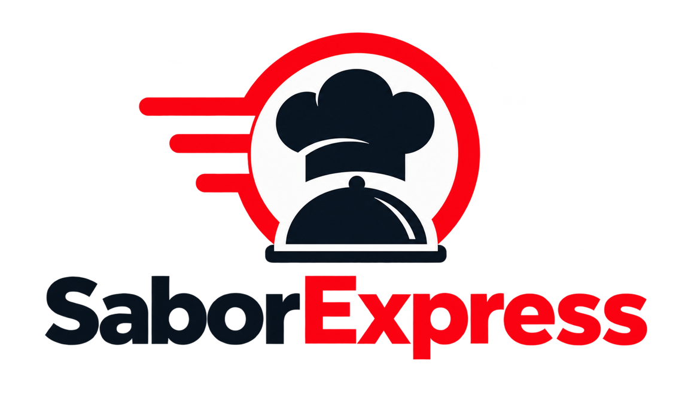

# SaborExpress — Expediente de ingeniería de software y documentación académica

**Integrante documentado:** Yerson Stiven Cuellar Rubiano  
**Ficha:** 3145555  
**Fecha de preparación:** 14 de octubre de 2026  
**Versión documental:** 4.0 (estudio de caso con pruebas pendientes)

## Resumen ejecutivo

SaborExpress es una plataforma de apoyo a operaciones gastronómicas, organizada en backend ASP.NET Core 8, interfaz administrativa Next.js y aplicación React Native / Expo. Se identifican módulos de sedes, catálogo, personas, pedidos, pagos Wompi, repartos, cocina y notificaciones. El expediente reúne investigación, requisitos, análisis, propuesta, diseño, diccionario de datos, API, manuales, riesgos, protocolos de QA y ejemplos técnicos. Las cifras empíricas no observadas están marcadas como pendientes.

## Organización del expediente

- `1-project-charter/`: definición, actores, alcance, entregables, riesgos y criterios de aceptación.
- `2-requirements/`: requisitos funcionales/no funcionales y trazabilidad.
- `3-analysis/`: negocio, casos de uso, reglas y flujo operativo.
- `4-design/`: estructura modular, decisiones, diagramas y propuesta.
- `5-database/`: diccionario y relaciones extraídos de modelos EF Core.
- `6-api/`: controladores y colección Postman inicial.
- `7-manuals/`: soporte técnico, instalación y uso por rol.
- `8-testing/`: plan con criterios y evidencia por completar.
- `9-traceability/`: mejoras, hallazgos y relación entre requisitos y pruebas.
- `10-deliverables/`: informe documental y presentación de revisión.
- `11-research/`: manuscritos científicos, bibliografía, metodología y protocolos.
- `12-governance/`: riesgos, configuración, ética y privacidad.
- `13-code-examples/`: comandos, SQL ilustrativo y escenarios de validación.
- `docs-SaborExpress/`: carpeta espejo de entregables académicos de SRD, incluidos DOCX/PDF/MD.
- `docs-SaborExpress/recursos/`: logotipo y 10 diagramas con código Graphviz editable.

## Fuentes primarias

- Backend: https://github.com/yersonct/SaborExpressBack
- Web: https://github.com/yersonct/SaborExpressWeb
- Móvil: https://github.com/yersonct/SaborExpressMovil
- Documentación: https://github.com/yersonct/SaborExpressDocs
- Referencia de estructura: https://github.com/jsgh1/SRD-v1/tree/dev/docs/docs-SRD

## Estado y limitaciones

**Producción, autorización docente, tiempos de respuesta, ejecución de pruebas, seguridad certificada y migraciones multi-proveedor:** NO verificados en este proceso. La documentación describe el código consultado y lo separa de decisiones recomendadas. Los cuatro PDF históricos del repositorio deben conservarse, no eliminarse por sustitución automática.

Para material de presentación consulte `MATRIZ-ENTREGA-PROFESIONAL.md`, `NORMAS-APA7-Y-ALCANCE.md` y `COMO-INTEGRAR-Y-SUBIR.md`. La autoría editorial debe revisarse si hubo más colaboradores; aquí se incluye el integrante informado por el usuario.
