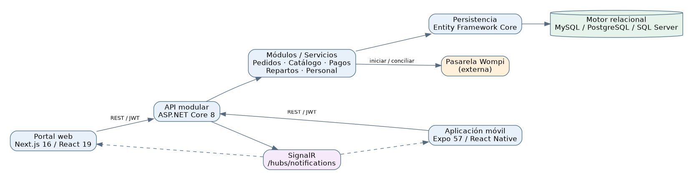
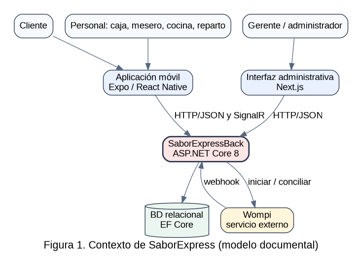
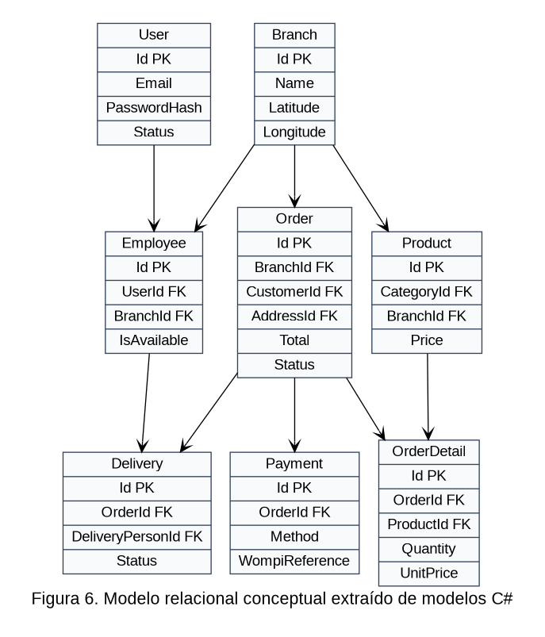
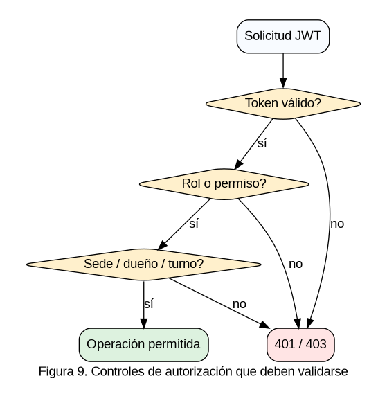

# Arquitectura y trazabilidad de una plataforma web y móvil para procesos gastronómicos: estudio de caso documental de SaborExpress

**Proyecto:** SaborExpress | **Autor / integrante:** Yerson Stiven Cuellar Rubiano | **Ficha:** 3145555 | **Fecha:** 14 de octubre de 2026 | **Versión documental:** 4.0

**Estado de la evidencia:** inspección documental y estática del código. Las pruebas de ejecución y los datos institucionales no aportados no se presumen realizados.

**Autores:** [Confirmar autores reales]  |  **Afiliación:** [Institución / programa]  |  **ORCID / correspondencia:** [Completar]  |  **Financiación:** no declarada hasta confirmación  |  **Fecha:** octubre de 2026

## Resumen
**Objetivo.** Caracterizar componentes, capacidades y limitaciones de validación de SaborExpress, una plataforma de gestión gastronómica con API central, portal web y aplicación móvil. **Método.** Se realizó un estudio de caso documental de enfoque descriptivo mediante inspección estática de código y manifiestos de tres repositorios públicos, complementada con una revisión bibliográfica dirigida de publicaciones sobre entrega digital de alimentos, arquitectura de software, aceptación tecnológica, seguridad y calidad. **Resultados.** Se identificó un servidor ASP.NET Core 8 con entidades EF Core, autenticación JWT, canal SignalR y controladores para pedidos, productos, sedes, cobros Wompi y entregas; un portal Next.js 16/React 19 y un cliente Expo/React Native. Se reconocieron relaciones de datos y 52 rutas HTTP en seis controladores examinados, sin resultados experimentales de desempeño o aceptación. **Conclusión.** La inspección respalda una caracterización técnica inicial y un plan de verificación de requisitos, pero no demuestra mejoras de productividad, seguridad operativa ni experiencia de usuarios. La aportación del estudio es una línea base reproducible para validación posterior.

**Palabras clave:** ingeniería de software; pedidos; restaurantes; integración web y móvil; pagos electrónicos; trazabilidad; estudio de caso.

## Abstract
**Objective:** To characterize the architecture, observable capabilities and verification gaps of SaborExpress, a restaurant-oriented system integrating an API, an administrative web portal and a mobile application. **Methods:** A descriptive documentary case study based on static inspection of three public source repositories and a targeted review of peer-reviewed research on online food delivery, software architecture, acceptance, quality and security. **Results:** The repositories show an ASP.NET Core 8 backend with EF Core entities, JWT, SignalR, controllers for orders, catalog, branches, Wompi payments and deliveries, a Next.js/React web client and an Expo/React Native mobile client. The inspected subset contains 52 HTTP route declarations across six controllers; deployment quality and operational success were not measured. **Conclusions:** The repositories support structural traceability but not claims of productivity gains, security compliance or customer satisfaction. The study proposes a reproducible validation agenda.

**Keywords:** software engineering; restaurant management; online food delivery; web and mobile architecture; digital payments; case study.

## 1. Introducción
Los servicios de alimentación combinan consumo digital, coordinación del punto de venta y logística de despacho. La literatura distingue dimensiones de adopción, experiencia, confianza, fiabilidad y operación: la revisión de Shroff et al. (2022) examinó 43 artículos y propuso líneas de investigación para la entrega de alimentos; una síntesis en *International Journal of Hospitality Management* (2022) identifica TAM, TPB y UTAUT como teorías frecuentes en este dominio. Estas publicaciones describen contextos diversos y no demuestran por sí mismas resultados para un restaurante colombiano concreto.

La creciente dependencia de aplicaciones web/móviles exige integrar pedidos, sus estados, montos, cuentas y reparto sin pérdida de trazabilidad. Un sistema puede contener controladores y pantallas completas, pero la existencia de código no equivale a calidad medida ni a operación sin incidentes. Surge así una cuestión metodológica relevante para proyectos académicos de ingeniería: ¿qué capacidades y riesgos de integración se pueden sustentar con inspección documental y cuáles requieren verificación experimental?

SaborExpress sirve como unidad de análisis porque organiza API, web y móvil en repositorios independientes. Su backend muestra una estructura por módulos de dominio, no una colección demostrada de microservicios. Este artículo caracteriza los componentes y el estado de evidencia, relaciona el diseño con marcos de literatura y establece pruebas para una evaluación futura.

## 2. Problema y preguntas de investigación
Una operación gastronómica necesita coordinar simultáneamente menú, sedes, personal, pedidos, caja y entregas. La duplicación de registros, la falta de sincronía entre cobro y estado de orden, o el acceso indebido a datos de otra sede son escenarios de riesgo plausibles. No se dispone de una línea base empírica de errores, tiempos o costos en el restaurante real; por consiguiente, no se afirma que SaborExpress haya reducido dichos problemas.

**Pregunta principal:** ¿qué arquitectura y capacidades de integración pueden verificarse mediante el análisis de los repositorios de SaborExpress y cuáles son las brechas para demostrar su calidad operacional?

**Subpreguntas:** P1: ¿qué tecnologías y módulos funcionales son visibles? P2: ¿qué contratos y relaciones de datos soportan los flujos críticos? P3: ¿qué controles de autorización y pagos merecen pruebas prioritarias? P4: ¿qué variables de calidad y aceptación derivadas de la literatura resultan pertinentes para evaluación posterior?

### Preguntas y operacionalización de variables
La pregunta general es: ¿qué evidencia documental aporta la implementación de SaborExpress sobre la integración funcional de una API central, clientes diferenciados y flujos críticos de restaurantes? Subpreguntas: (P1) ¿qué capacidades se pueden identificar directamente en el código? (P2) ¿qué decisiones arquitectónicas estructuran el sistema? (P3) ¿qué riesgos emergen de la intersección entre pedidos, pagos, entregas y autorización? (P4) ¿qué evidencias adicionales son necesarias para afirmar calidad o preparación operativa?

El estudio se delimita a los artefactos disponibles públicamente en octubre de 2026 y a literatura académica que describe plataformas de distribución de comida, modelos de aceptación tecnológica, arquitectura y seguridad. No plantea hipótesis estadísticas ni reclama causalidad: una inspección de archivos no permite medir reducción de tiempos, satisfacción ni ingresos. La unidad primaria de análisis es el repositorio, y las unidades internas son controladores, modelos de dominio, rutas y dependencias. Los criterios de observación se establecieron previamente para reducir interpretación subjetiva.

## 3. Objetivos
**General:** caracterizar técnicamente SaborExpress y construir una línea base documental verificable que permita orientar su validación funcional, arquitectónica y de seguridad.

**Específicos:** identificar componentes de cada repositorio; extraer controladores, modelos de dominio y flujos de pago/entrega; contrastar hallazgos con literatura y estándares; definir trazabilidad requisito-prueba; presentar límites y amenazas a la validez.

## 4. Marco conceptual y trabajos relacionados
### 4.1. Plataformas de entrega y calidad percibida

Shroff, Shah y Gajjar (2022) organizan resultados de investigación sobre entrega en línea y sus múltiples actores. La síntesis de 2022 publicada en IJHM destaca teorías de aceptación y enfoques metodológicos, lo cual ayuda a evitar reducir este problema al catálogo digital. Un trabajo sobre atributos de servicios de aplicaciones de entrega (2021, DOI 10.1016/j.ijgfs.2021.100392) analizó relaciones entre experiencia, facilidad de uso, repartidor y satisfacción en un contexto extranjero. El modelo de calidad del servicio en *British Food Journal* (2022) relaciona fiabilidad, seguridad, operación del sistema y satisfacción. Esos antecedentes orientan las variables a medir, pero sus resultados estadísticos no se extrapolan a este caso.

### 4.2. Contexto colombiano

García-Umaña y colaboradores (2026) estudiaron la continuidad de uso de plataformas de entrega en Colombia utilizando una extensión de UTAUT2 con confianza en entrega y percepción de calidad alimentaria. Su estudio aplica un diseño de encuesta, distinto de la inspección de código aquí desarrollada. Aporta variables relevantes para un eventual piloto local —confianza, expectativa de desempeño y calidad percibida—, sin demostrar aceptación de SaborExpress.

### 4.3. Adopción y experiencia de usuario

Davis (1989) distingue utilidad y facilidad de uso percibidas; Venkatesh et al. (2003) integran determinantes de aceptación en UTAUT. Nielsen (1994, revisión 2024) plantea principios heurísticos como visibilidad de estado, consistencia y prevención de errores. Para una plataforma de pedidos estos referentes motivan comprobar feedback de pago pendiente, prevención de doble cobro, retroalimentación ante pérdida de red y claridad de estados en cocina y reparto.

### 4.4. Arquitectura, calidad y seguridad

Kruchten (1995) explica la utilidad de vistas arquitectónicas separadas por interés. Taibi, Lenarduzzi y Pahl (2018) clasifican patrones de microservicios; esto permite precisar que el código observado corresponde a un **backend modular dentro de un proyecto .NET** y no justificar la etiqueta de microservicios sin despliegues autónomos. ISO/IEC/IEEE 29148:2018 orienta requisitos rastreables, ISO/IEC 25010:2023 define un modelo de calidad de nueve características, mientras OWASP API Security Top 10 (2023) y NIST SP 800-63B-4 (2025) proporcionan categorías de riesgos/autenticación. Los documentos son referencias de evaluación y no pruebas de conformidad.

### Experiencia, confianza y calidad del servicio
La literatura sobre entrega de alimentos en línea describe un entorno multifacético: la experiencia del usuario no depende únicamente del software, sino de información del catálogo, tiempos de entrega, confianza, disponibilidad y coordinación entre actores. Shroff, Shah y Gajjar (2022) sintetizaron 43 artículos de 24 revistas y señalaron oportunidades de investigación que justifican analizar la orquestación y las relaciones entre actores. Esa síntesis no autoriza a extrapolar porcentajes de éxito a SaborExpress, pero sí proporciona categorías para examinar el valor del sistema.

El modelo TAM de Davis (1989) plantea utilidad y facilidad de uso percibidas como determinantes de adopción; Venkatesh y colaboradores (2003) integran factores de intención y uso en UTAUT. En una plataforma gastronómica, estos enfoques orientan preguntas sobre facilidad para registrar un pedido, confianza al pagar, percepción de claridad del estado y condiciones facilitadoras del personal. En esta investigación los modelos cumplen una función conceptual: no se aplicó TAM ni UTAUT a participantes, de modo que no se reportan puntuaciones de aceptación.

Prasetyo y colaboradores (2021) evaluaron factores relacionados con satisfacción y lealtad de clientes en plataformas de entrega durante la pandemia, en un contexto ajeno al del restaurante estudiado. La validez externa de tales hallazgos debe discutirse antes de transferirlos a Colombia. De igual manera, las heurísticas de Nielsen, revisadas en 2024, sirven para planear una inspección de las pantallas de SaborExpress (visibilidad del estado, prevención de errores, consistencia y recuperación), no para calificar sin evidencia su usabilidad.

## 5. Metodología
### 5.1. Diseño y delimitación

Estudio de caso descriptivo, no experimental, documental y de corte transversal. Inspirado en la investigación por estudio de caso de Yin (2018). Se revisaron las estructuras públicas de `yersonct/SaborExpressBack`, `yersonct/SaborExpressWeb`, `yersonct/SaborExpressMovil` y el repositorio documental, durante octubre de 2026. El análisis no reunió participantes ni datos de ventas. La búsqueda bibliográfica fue dirigida y **no cumple los pasos de una revisión sistemática PRISMA**; no se reportan recuentos ficticios de cribado.

### 5.2. Selección y procedencia de fuentes

Se priorizaron: archivos de inicio (`Program.cs`), manifiestos (`SaborExpress.csproj`, `package.json`), registro de dependencias, controladores críticos, modelos EF Core y documentación relacionada. La literatura seleccionada comprende revistas con DOI y fuentes primarias de estándares y marcos técnicos. La evidencia de código se clasificó como: O (observación directa), I (interpretación razonable) o P (prueba pendiente).

### 5.3. Procedimiento de extracción

Paso 1: reconocer estructura y tecnologías por manifiesto; paso 2: identificar fronteras HTTP y servicios; paso 3: contrastar entidades y relaciones; paso 4: identificar operaciones Wompi y SignalR; paso 5: contrastar documentación actual con código; paso 6: desarrollar matrices de requisitos, prueba y riesgos; paso 7: discutir resultados a la luz de trabajos científicos sin causalidad ficticia.

### 5.4. Reproducibilidad y control de sesgos

Se registran rutas fuente concretas y URLs. Para repetición exacta se deben fijar los SHA de cada repositorio, dado que `main` puede avanzar. No se evaluó el tráfico HTTP real, base de datos ejecutándose ni controles de seguridad en entorno operativo. La revisión depende de lo visible, puede omitir comportamiento condicionado por configuración y no permite inferir satisfacción.

### Procedimiento de extracción y clasificación de evidencia
La inspección documental se organiza en cinco etapas reproducibles. Primera: identificar la rama y registrar commit SHA de cada repositorio. Segunda: reconocer tecnologías a través de archivos de manifiesto, en particular `SaborExpress.csproj`, `package.json` y configuraciones. Tercera: localizar controladores HTTP y relaciones de datos a partir de `Controllers`, `Data/AppDbContext.cs.cs` y modelos de los módulos. Cuarta: describir relaciones y restricciones visibles, etiquetando como hipótesis cualquier comportamiento no comprobado. Quinta: cotejar cada afirmación con bibliografía y mapear amenazas técnicas a pruebas de aceptación.

Se emplea una matriz de extracción con campos: identificador de evidencia, repositorio, ruta, símbolo o ruta HTTP, comportamiento declarado, nivel de confianza, riesgo y prueba faltante. Es importante diferenciar evidencia de estructura (archivo presente), evidencia de implementación (método y dependencia presente) y evidencia empírica (escenario ejecutado y observado). La presente investigación alcanza principalmente los dos primeros niveles. Los datos personales, secretos y transacciones reales quedan fuera del protocolo de extracción.

## 6. Resultados de la inspección
### 6.1. Stack y organización

El archivo `.csproj` declara `net8.0`. `Program.cs` registra controladores, JWT, autorización `ActiveShift`, servicios hospedados, Swagger, SignalR y migración/seeding de BD en arranque. `DatabaseConfiguration.cs` implementa selección por valores de cadena `MySQL`, `PostgreSQL` o `SqlServer`. Web declara Next.js 16.2.6 y React 19.2.4. Móvil declara Expo 57 y React Native 0.86.3. Estas son dependencias **declaradas**, no una inspección de infraestructura en producción.

### 6.2. Contratos e integraciones

Se registró un subconjunto de 52 acciones anotadas con verbos HTTP en los controladores Auth, Orders, Products, Payments, Deliveries y Branches. Existen más controladores para empleados, categorías, notificaciones, configuraciones, mesas y otros dominios; por tanto, 52 no es el número de endpoints total del proyecto. El catálogo técnico documenta rutas y métodos del subconjunto examinado. Los controladores permiten caracterizar flujos como alta de pedido, consulta por sede, cobro con Wompi y gestión de reparto; su ejecución no fue observada.

### 6.3. Entidades y relaciones

La clase `Order` referencia `Branch`, `Customer`, `Employee`, `Table`, `Address` y colecciones `OrderDetail`, `OrderStatusHistory` y `Payment`. La clase `Payment` contiene referencia externa e identificador Wompi; `Delivery` registra estado, fechas y calificación opcional. `Product` puede estar asociado a una sucursal o configurado como global con `BranchId` nulo. Los datos provienen de modelos; no constituyen validación del esquema físico del motor.

### 6.4. Riesgos específicos observables

La configuración CORS de `Program.cs` incluye orígenes de entorno local/dev tunnels independientemente del ambiente, criterio que debe endurecerse antes de exposición pública. Se identificó migración automática en arranque. `PaymentsController` recibe webhooks con excepción a la autorización de clase y escribe el body recibido a log; la seguridad efectiva dependerá de validación de firma en servicio y revisión del contenido registrado. `BranchesController` mantiene `[Authorize]` de clase en acciones llamadas `public`/`nearest`, sin `[AllowAnonymous]` visible; corresponde revisar el acceso esperado. Estos puntos son objetos de auditoría, **no fallos explotados**.

*Figura 1. Componentes identificados; diagrama lógico derivado de repositorios, no topología productiva comprobada.*

### 6.5. Estado de evidencias

| Hallazgo verificable | Archivo inspeccionado | Alcance de la afirmación |
|---|---|---|
| Backend ASP.NET Core 8 | `SaborExpressBack/SaborExpress.csproj` | TargetFramework net8.0; no prueba de despliegue |
| Registro de JWT, Swagger, SignalR y servicios en segundo plano | `SaborExpressBack/Program.cs` | Registro de componentes; no certifica seguridad operativa |
| Persistencia EF Core y migraciones | `SaborExpressBack/Data/AppDbContext.cs.cs`, `Program.cs` | Modelos y arranque con MigrateAsync; debe probarse por motor |
| Proveedores MySQL, PostgreSQL y SQL Server seleccionables | `SaborExpressBack/Configuration/DatabaseConfiguration.cs` | Soporte programado; compatibilidad real por motor no validada |
| Autenticación y recuperación de cuentas | `SaborExpressBack/Controllers/AuthController.cs` | Acciones HTTP presentes |
| Creación, consulta, modificación y cancelación de pedidos | `SaborExpressBack/Controllers/OrdersController.cs` | Acciones presentes; flujos sin test ejecutado |
| Wompi: inicio, QR, webhook y sincronización | `SaborExpressBack/Controllers/PaymentsController.cs` | Controlador presente; pagos reales no verificados |
| Estado y calificación de repartos | `SaborExpressBack/Controllers/DeliveriesController.cs` | Acciones presentes |
| Productos públicos, gestión y estado | `SaborExpressBack/Controllers/ProductsController.cs` | Acciones presentes |
| Next.js 16.2.6 y React 19.2.4 | `SaborExpressWeb/package.json` | Versiones declaradas |
| Rutas web de pedidos, empleados, sedes y reportes | `SaborExpressWeb/src/app/.../page.tsx` | Archivos de página identificados |
| Expo 57, React Native 0.86.3 y SignalR | `SaborExpressMovil/package.json` | Dependencias declaradas |

### Resultados técnicos detallados
El backend declara `.NET 8` y bibliotecas de autenticación JWT, EF Core, Swagger y proveedores relacionales. La clase `Program.cs` registra la infraestructura HTTP, SignalR, controles de turno y varios procesos de fondo. La arquitectura se comporta, desde el punto de vista estático, como una aplicación ASP.NET Core modular con diferentes grupos de dominio: no se observaron evidencias que permitan describirla como sistema de microservicios independientes. La implementación del cliente web utiliza Next.js 16 y React 19; la móvil declara Expo 57 y React Native 0.86.

El `OrdersController` contiene endpoints para crear, consultar, actualizar, cambiar estado y cancelar pedidos. La entidad Order vincula cliente y empleado opcionales, mesa, sucursal, dirección, tipo, canal, estados y montos; `OrderDetail` relaciona productos con cantidad, precio unitario y subtotal. Este diseño expresa que una sola operación de negocio puede originarse desde distintos canales. Sin embargo, que la estructura lo permita no prueba integridad bajo concurrencia ni autoriza afirmar que cada canal esté validado en producción.

`PaymentsController` contiene mecanismos de inicio Wompi para cliente y cajero, webhook, consulta y sincronización. `Payment` almacena referencia y transacción externa y admite cajero nulo. Dada la importancia de la integridad financiera, el principal riesgo no es solo la caída del proveedor: también existen eventos duplicados, firmas alteradas, retraso de callback y carreras entre cancelación y confirmación. La documentación oficial de eventos Wompi exige una comprobación de integridad criptográfica y diferencias entre ambientes. La inspección de un controlador que delega payload y checksum al servicio es evidencia de integración, no una prueba de firma correcta o idempotencia.

`DeliveriesController` describe asignación, consulta por orden o trabajador, estados y calificación. Los modelos contienen vínculos con pedido, dirección y empleado; algunos métodos muestran comprobaciones explícitas de rol y sede. Se identifican así relaciones de propiedad que justifican ensayos de acceso horizontal (dos repartidores) y vertical (cliente intentando función administrativa). OWASP API Security Top 10 (2023) destaca la autorización a nivel de objeto como una categoría crítica; la prevención debe ejecutarse en servidores, aun cuando las aplicaciones oculten botones según el rol.

La configuración de base de datos selecciona MySQL, SQL Server o PostgreSQL. La capacidad de elegir proveedor es una propiedad del código, pero no debe confundirse con compatibilidad de migraciones demostrada: la semántica SQL y los índices pueden variar entre motores. También se detecta migración al arranque mediante `MigrateAsync()`, que en producción demanda coordinación para evitar ejecuciones concurrentes y controlar el retroceso. Estos hallazgos se convierten en requisitos de operación y no en defectos confirmados, pues carecen de ensayos que demuestren fallos.

## 7. Discusión
Los hallazgos corresponden a integración funcional potencialmente significativa, porque comparten un modelo de negocio para pedidos, cobros y entregas, pero la existencia de endpoints no autoriza afirmar productividad o calidad de servicio. La revisión de Shroff et al. y la literatura de calidad sugieren que fiabilidad, confianza y claridad operativa son aspectos centrales; no se midieron esas variables aquí. Las teorías TAM y UTAUT son apropiadas para diseñar instrumentos futuros con usuarios reales y consentimiento.

En términos de arquitectura, la modularización de un backend central tiene un balance de despliegue diferente de microservicios desplegados por separado: no se debe atribuir escalabilidad por componente sin topología, pruebas de carga y acuerdos de aislamiento. La posibilidad de seleccionar tres proveedores EF Core puede favorecer portabilidad, pero cada proveedor debe superar scripts, constraints y migraciones en condiciones controladas.

La coordinación de pagos muestra un riesgo operacional particular: un webhook asíncrono duplicado o fuera de orden puede generar inconsistencias. Por ello se requiere idempotencia verificable y reconciliación por referencia/transacción, y separar la afirmación «tiene una integración» de «la transacción es segura y correcta». La misma distinción aplica a JWT, SignalR y control de sedes: registrar tecnología no demuestra propiedad de seguridad ni latencia bajo carga.

### Análisis crítico desde atributos de calidad
El modelo ISO/IEC 25010:2023 ofrece una taxonomía de características para evaluar software y productos TIC; en este caso se adopta como marco de preguntas, no como acreditación. Para la adecuación funcional, se requiere demostrar que la API, web y móvil cumplen las mismas reglas de pedidos, pagos y entregas. Para rendimiento, registrar tiempos p50/p95 y carga concurrente, definiendo antes el tamaño del conjunto de datos. Para compatibilidad, verificar navegadores, dispositivos y versión Expo; para confiabilidad, someter la base y la red a fallas controladas. Para seguridad, abordar identidad, propiedad de datos, pasarela y gestión de secretos. Para mantenibilidad, revisar fronteras de módulos y cobertura de pruebas.

Un riesgo especialmente relevante es la deriva contractual entre repositorios independientes. Un campo, permiso o estado modificado en el backend puede producir errores silenciosos en clientes web o móvil. La recomendación es versionar el OpenAPI, mantener una colección automatizada de contratos y utilizar pruebas de regresión que cubran estados excepcionales. Esta decisión no exige migrar a microservicios. Por el contrario, el monolito modular puede ser adecuado si el costo operacional es limitado y las fronteras de negocio están claras.

La experiencia del usuario debe tratarse como proceso completo: descubrimiento de producto, composición del pedido, confirmación del pago, seguimiento y recepción. Notificaciones rápidas pueden mejorar percepción, pero SignalR no constituye prueba de entrega garantizada. Se requiere reconciliación mediante API cuando el dispositivo pierde conexión. Además, un error de red después de pagar puede provocar reintentos; la interfaz debe explicar que un pago pendiente no implica necesariamente un cobro fallido.

### Aportes, transferibilidad y validez
El aporte central no reside en demostrar superioridad comercial frente a plataformas conocidas, sino en presentar una trazabilidad de código a decisiones de ingeniería para un sistema gastronómico con varios perfiles. A diferencia de trabajos basados en cuestionarios de intención de uso, este estudio examina una implementación técnica observable. Esa diferencia impide comparar porcentajes de satisfacción con estudios como Prasetyo et al. (2021), pero permite formular escenarios de aceptación concretos.

La validez de constructo está limitada porque funciones recuperadas de los controladores pueden no corresponder exactamente a la experiencia actual de la interfaz; por eso se distinguen puntos de entrada y aceptación efectiva. La validez interna se limita a una inspección estática sin pruebas de concurrencia, seguridad dinámica o observación de usuarios. La validez externa se reduce al ecosistema examinado: no es legítimo generalizar hallazgos de tres repositorios a todos los sistemas de restaurantes. La confiabilidad mejora al indicar rutas de origen, separar conjeturas y conservar un protocolo de extracción repetible.

Desde la gestión de calidad, el siguiente salto metodológico es ejecutar pruebas con datos sintéticos que cubran firmas Wompi inválidas, pagos repetidos, cancelaciones tardías, administración intersede, pérdida de red, carga moderada y restauración. Para un estudio de usuarios futuro, se necesitarían consentimientos informados, definición de muestra, tareas, instrumento y manejo ético de datos. Solo después sería posible contrastar resultados con teoría TAM/UTAUT o afirmar mejoras cuantificables.

Otro límite es la disponibilidad parcial de especificaciones normativas: los estándares ISO son de distribución restringida. Se utilizan sus descripciones oficiales y objetivos generales, sin reproducir contenido licenciado ni reclamar conformidad certificada.

## 8. Protocolo de validación futura
| Dimensión | Indicador propuesto | Diseño de evaluación | Situación |
| --- | --- | --- | --- |
| Funcional | Porcentaje de RF prioritarios aprobados | Batería positiva/negativa por rol | Sin ejecutar |
| Seguridad | Accesos indebidos entre usuarios/sedes | OWASP API1/API5, recursos cruzados | Sin ejecutar |
| Pagos | Eventos duplicados, montos conciliados | Sandbox Wompi, checksum y replay | Sin ejecutar |
| Rendimiento | Latencias HTTP p50/p95 y carga definida | k6/JMeter + trazas | Sin ejecutar |
| Tiempo real | Entrega/reconexión SignalR | Clientes simultáneos y desconexión | Sin ejecutar |
| Usabilidad | Éxito, tiempo y errores por tarea | Participantes y consentimiento | Sin ejecutar |
| Fiabilidad | Backup/restore, recuperación | Fallas inyectadas en ambiente test | Sin ejecutar |

Cada estudio deberá definir muestra, condiciones, protocolo ético, instrumentación, hipótesis falsables, registro de SHA y análisis de resultados. No se adjuntan tablas de resultados sintéticos como si fueran experimentales.

### Agenda de evaluación e indicadores
| Dimensión | Variable medible | Instrumento propuesto | Restricción metodológica |
| --- | --- | --- | --- |
| Integridad | eventos Wompi duplicados que producen doble cobro | sandbox y fixtures firmados | sin pagos reales |
| Seguridad | accesos fuera de sede/propietario | matriz de roles y API tests | en entorno autorizado |
| Rendimiento | p50/p95 creación pedido y consulta | k6/JMeter con usuarios ficticios | configuración versionada |
| Usabilidad | éxito/errores por tarea | observación guiada y consentimiento | requiere personas reales |
| Fiabilidad | reconexiones y reconciliación de estado | corte red y consulta GET | sin extrapolar a operación 24/7 |
| Mantenibilidad | cambio de DTO rompe cliente | OpenAPI diff + pruebas de contrato | declarar versiones |
| Recuperación | integridad tras restauración | snapshot y conteo relaciones | entorno aislado |

## 9. Amenazas a la validez y limitaciones
**Constructo:** la presencia de una ruta no equivale a funcionamiento; no se atribuyen métricas. **Interna:** configuraciones y servicios no ejecutados pueden cambiar el comportamiento. **Externa:** los estudios de otras jurisdicciones no generalizan a SaborExpress ni a Colombia por defecto; se incluye un antecedente colombiano como contexto. **Replicabilidad:** las ramas pueden modificarse y se deben fijar commits. **Sesgo documental:** faltan evidencias de UX, operaciones y seguridad.

## 10. Conclusiones
SaborExpress exhibe un proyecto de software con backend modular y dos clientes, orientado a un dominio en el que la exactitud de estados y autorizaciones importa tanto como la interfaz de usuario. El código permite identificar recursos y contratos para clientes, trabajadores, sucursales, pedidos, cobros y repartos; de manera simultánea, revela las superficies que deben concentrar QA y control de cambios. El examen sostiene una descripción arquitectónica documentada, pero no valida por sí solo funcionalidad end-to-end ni calidad no funcional.

La ruta profesional consiste en mantener las fuentes documentales sincronizadas con un SHA, exportar contratos y esquema reales, ejecutar pruebas bajo entornos y datos controlados, cuantificar los resultados y someter las conclusiones a revisión técnica y académica. Esta distinción entre implementación visible y eficacia medida es fundamental para que el artículo sea verificable y éticamente defendible.

La inspección de código sitúa a SaborExpress como una solución multicliente con backend ASP.NET Core modular, persistencia EF Core y canales REST/SignalR; dispone de controladores y modelos para casos relevantes de restaurante, pedidos, pagos electrónicos y logística de reparto. La contribución científica de este estudio es una caracterización trazable y un método de evaluación replicable, no un efecto causal demostrado sobre un negocio. Un siguiente estudio deberá medir autorización, integridad de pagos, rendimiento y utilidad percibida con datos observados.

## 11. Declaraciones
**Ética:** no se recopilaron datos personales de participantes ni credenciales. **Datos:** repositorios públicos citados; no se procesó una base productiva. **Financiación / conflictos / contribuciones:** deben ser confirmados por autores reales. **Uso de IA y edición:** declarar según norma institucional/editorial.

## Referencias
Davis, F. D. (1989). Perceived usefulness, perceived ease of use, and user acceptance of information technology. *MIS Quarterly, 13*(3), 319–340. https://doi.org/10.2307/249008

Expo. (s. f.). *Expo documentation*. https://docs.expo.dev/

Fakfare, P. (2021). Influence of service attributes of food delivery application on customers’ satisfaction and their behavioural responses: The IPMA approach. *International Journal of Gastronomy and Food Science, 25*, 100392. https://doi.org/10.1016/j.ijgfs.2021.100392

Fielding, R., Nottingham, M., & Reschke, J. (2022). *HTTP semantics* (RFC 9110). Internet Engineering Task Force. https://www.rfc-editor.org/rfc/rfc9110

García-Umaña, A., Bernal-Peralta, J., Cevallos Uve, G. E., Alcívar Chávez, A. C., Córdoba, É. F., & Beserra, V. (2026). Continuance intention in online food delivery platforms in Colombia: Extending UTAUT2 with delivery trust and food quality perception. *Foods, 15*(14), 2430. https://doi.org/10.3390/foods15142430

GitHub. (s. f.). *GitHub Actions documentation*. https://docs.github.com/en/actions

ISO/IEC. (2023). *ISO/IEC 25010:2023: Systems and software engineering — Systems and software Quality Requirements and Evaluation (SQuaRE) — Product quality model*. https://www.iso.org/standard/78176.html

ISO/IEC/IEEE. (2018). *ISO/IEC/IEEE 29148:2018: Systems and software engineering — Life cycle processes — Requirements engineering*. https://www.iso.org/standard/72089.html

Jones, M., Bradley, J., & Sakimura, N. (2015). *JSON Web Token (JWT)* (RFC 7519). Internet Engineering Task Force. https://www.rfc-editor.org/rfc/rfc7519

Kitchenham, B., & Charters, S. (2007). *Guidelines for performing systematic literature reviews in software engineering* (EBSE-2007-01). https://homepages.dcc.ufmg.br/~figueiredo/disciplinas/papers/guidelines-kitchenham.pdf

Koay, K. Y., Cheah, C. W., & Chang, Y. X. (2022). A model of online food delivery service quality, customer satisfaction and customer loyalty: A combination of PLS-SEM and NCA approaches. *British Food Journal, 124*(12), 4516–4532. https://doi.org/10.1108/BFJ-10-2021-1169

Kruchten, P. (1995). The 4+1 view model of architecture. *IEEE Software, 12*(6), 42–50. https://doi.org/10.1109/52.469759

Microsoft. (s. f.). *ASP.NET Core documentation*. https://learn.microsoft.com/en-us/aspnet/core/

Microsoft. (s. f.). *Entity Framework Core documentation*. https://learn.microsoft.com/en-us/ef/core/

Microsoft. (s. f.). *SignalR documentation*. https://learn.microsoft.com/en-us/aspnet/core/signalr/introduction

Next.js. (s. f.). *Next.js documentation*. https://nextjs.org/docs

Nielsen, J. (2024). *10 usability heuristics for user interface design*. Nielsen Norman Group. https://www.nngroup.com/articles/ten-usability-heuristics/

OWASP Foundation. (2023). *OWASP API Security Top 10 — 2023*. https://owasp.org/API-Security/

Postman. (s. f.). *Collections overview*. https://learning.postman.com/docs/collections/collections-overview/

Prasetyo, Y. T., Tanto, H., Mariyanto, M., Hanjaya, C., Young, M. N., Persada, S. F., Miraja, B. A., & Redi, A. A. N. P. (2021). Factors affecting customer satisfaction and loyalty in online food delivery service during the COVID-19 pandemic: Its relation with open innovation. *Journal of Open Innovation: Technology, Market, and Complexity, 7*(1), 76. https://doi.org/10.3390/joitmc7010076

Project Management Institute. (2021). *A guide to the project management body of knowledge (PMBOK® Guide)* (7th ed.). https://www.pmi.org/pmbok-guide-standards/foundational/pmbok

Shankar, A., Jebarajakirthy, C., Nayal, P., Maseeh, H. I., Kumar, A., & Sivapalan, A. (2022). Online food delivery: A systematic synthesis of literature and a framework development. *International Journal of Hospitality Management, 104*, 103240. https://doi.org/10.1016/j.ijhm.2022.103240

Shroff, A., Shah, B. J., & Gajjar, H. (2022). Online food delivery research: A systematic literature review. *International Journal of Contemporary Hospitality Management, 34*(8), 2852–2883. https://doi.org/10.1108/IJCHM-10-2021-1273

Taibi, D., Lenarduzzi, V., & Pahl, C. (2018). Architectural patterns for microservices: A systematic mapping study. In *Proceedings of the 8th International Conference on Cloud Computing and Services Science* (pp. 221–232). https://doi.org/10.5220/0006798302210232

Temoshok, D., Choong, Y.-Y., Regenscheid, A., Galluzzo, R., Fenton, J., Richer, J., & Lefkovitz, N. (2025). *Digital identity guidelines: Authentication and authenticator management* (NIST SP 800-63B-4). National Institute of Standards and Technology. https://doi.org/10.6028/NIST.SP.800-63B-4

Venkatesh, V., Morris, M. G., Davis, G. B., & Davis, F. D. (2003). User acceptance of information technology: Toward a unified view. *MIS Quarterly, 27*(3), 425–478. https://doi.org/10.2307/30036540

Wompi. (s. f.). *Documentación para desarrolladores*. https://docs.wompi.co/

Yin, R. K. (2018). *Case study research and applications: Design and methods* (6th ed.). SAGE Publications. https://study.sagepub.com/yin6e

## Anexo A. Figuras de arquitectura y trazabilidad del estudio de caso

Los siguientes diagramas presentan una reconstrucción conceptual basada en contratos y modelos del repositorio. La primera figura evidencia la coexistencia de un backend ASP.NET Core y dos clientes diferenciados. La segunda representa relaciones entre entidades de dominio: no debe leerse como un DDL exportado. La tercera sitúa controles de autorización y pruebas de seguridad recomendados. Se incluyen para facilitar reproducibilidad de los hallazgos documentales, no para simular un experimento.

*Nota. Elaboración para el estudio de caso SaborExpress; las figuras no certifican operaciones desplegadas.*

*Nota. Elaboración para el estudio de caso SaborExpress; las figuras no certifican operaciones desplegadas.*

*Nota. Elaboración para el estudio de caso SaborExpress; las figuras no certifican operaciones desplegadas.*
## Anexo B. Delimitación metodológica y amenazas a la validez

**Validez de constructo:** observar una ruta HTTP no demuestra que todas las reglas del negocio se cumplan en producción. Se registran hallazgos de estructura y recomendaciones de verificación por separado. **Validez interna:** no se han ejecutado comparaciones antes/después ni asignación aleatoria; por tanto no se atribuye reducción de tiempos, incremento de ventas o mejor satisfacción al sistema. **Validez externa:** el estudio aborda un único proyecto y su arquitectura; las conclusiones no se extrapolan a todo el sector gastronómico colombiano. **Confiabilidad:** el procedimiento es reproducible conservando SHA de repositorios, rutas y criterios de codificación, sujeto a disponibilidad pública de archivos y versiones.

**Protección de datos:** se emplean únicamente identificadores de rutas y modelos de software; no se extraen direcciones, cuentas, documentos ni transacciones reales. Se propone para investigación posterior un consentimiento informado si participan usuarios y tratamiento ético de registros de interacción.

**Protocolo propuesto:** congelar versiones, habilitar entorno sintético, ejecutar contratos REST y pruebas de permiso, medir duración y tasa de error con carga declarada, comparar tareas con participantes autorizados, analizar resultados con intervalos y reportar también resultados negativos. Este plan no se reporta como ejecutado.

