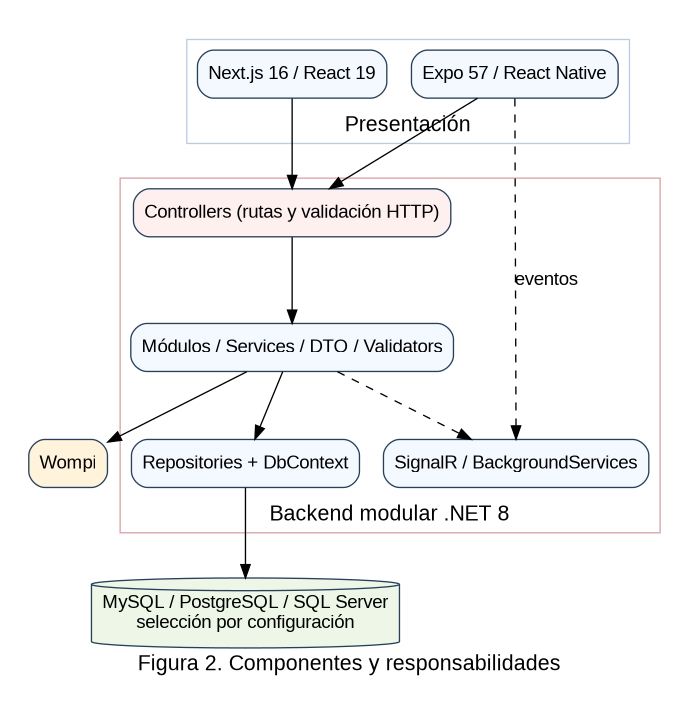
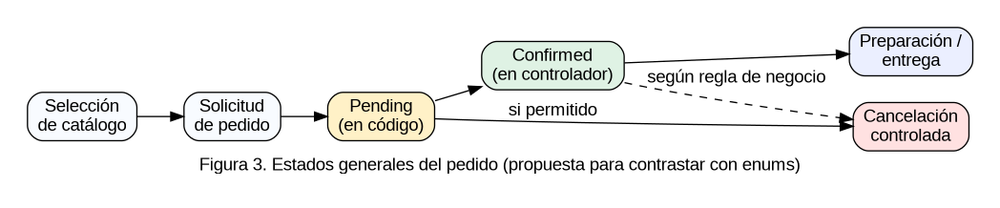
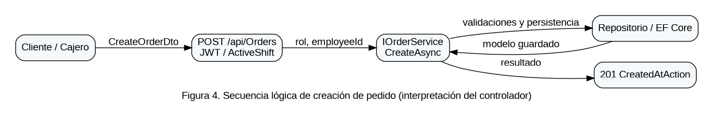
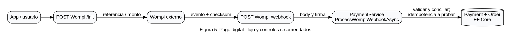
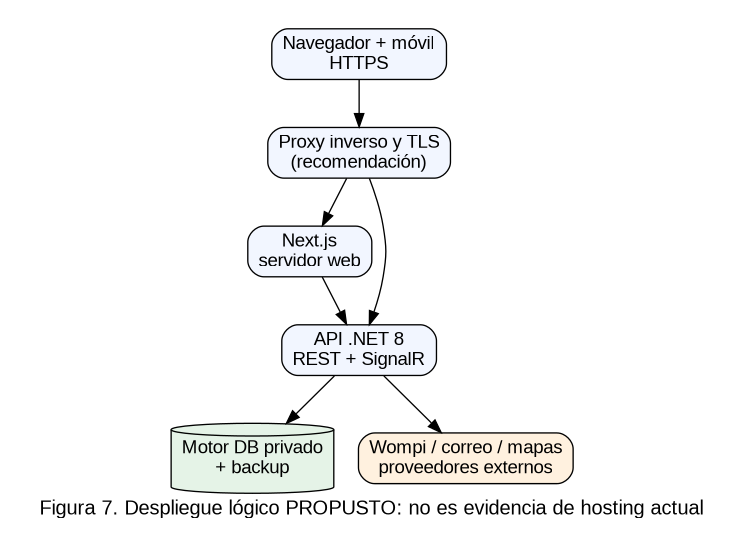
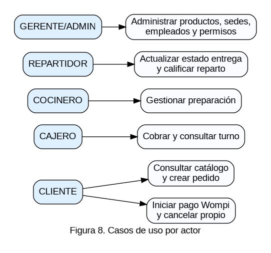
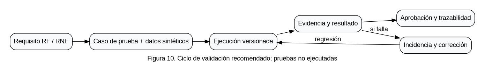

# Atlas de diagramas del proyecto SaborExpress

**Autor:** Yerson Stiven Cuellar Rubiano. **Ficha:** 3145555. **Fecha:** 14 de octubre de 2026.

Los diez diagramas siguientes se crearon para el expediente a partir de la estructura inspeccionada y de propuestas explícitas. Los archivos `recursos/*.dot` son los fuentes editables de Graphviz, acompañados de PNG. Se identifican como propuestas todos los despliegues, guardias y pruebas no verificados.

## 1. 01 Context0

*Nota. Elaboración para el estudio de caso SaborExpress; las figuras no certifican operaciones desplegadas.*
## 2. 02 Componentes

*Nota. Elaboración para el estudio de caso SaborExpress; las figuras no certifican operaciones desplegadas.*
## 3. 03 Flujo Pedido

*Nota. Elaboración para el estudio de caso SaborExpress; las figuras no certifican operaciones desplegadas.*
## 4. 04 Sequence Order

*Nota. Elaboración para el estudio de caso SaborExpress; las figuras no certifican operaciones desplegadas.*
## 5. 05 Sequence Payment

*Nota. Elaboración para el estudio de caso SaborExpress; las figuras no certifican operaciones desplegadas.*
## 6. 06 Modelo Er

*Nota. Elaboración para el estudio de caso SaborExpress; las figuras no certifican operaciones desplegadas.*
## 7. 07 Despliegue Propuesto

*Nota. Elaboración para el estudio de caso SaborExpress; las figuras no certifican operaciones desplegadas.*
## 8. 08 Casos Uso

*Nota. Elaboración para el estudio de caso SaborExpress; las figuras no certifican operaciones desplegadas.*
## 9. 09 Aislamiento Roles

*Nota. Elaboración para el estudio de caso SaborExpress; las figuras no certifican operaciones desplegadas.*
## 10. 10 Ciclo Qa

*Nota. Elaboración para el estudio de caso SaborExpress; las figuras no certifican operaciones desplegadas.*
